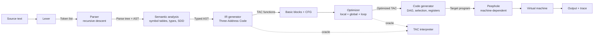

# 02 — Compiler Architecture and Technology Stack

> **Status:** Batch 1 draft for group review. Stack and module boundaries below are decisions, not options.
> **Related:** language `01_LANGUAGE_SPECIFICATION.md` · UI `03_UI_UX_SPECIFICATION.md` · data contracts `12_API_AND_DATA_CONTRACTS.md` (Batch 4) · per-phase specs `04`–`11` (Batches 2–3).

---

## 1. Architectural principles

| ID | Principle | Enforcement |
|---|---|---|
| AP-1 | The compiler is a **pure Python library** (`vela`) with no web or UI imports. The HTTP API and a CLI are thin adapters over it. | Test: `import vela` works without FastAPI installed. |
| AP-2 | Each phase is a **pure function** of the previous phase's immutable output plus options. No global mutable state, no singletons. | Code review checklist; tests call phases in isolation. |
| AP-3 | Every phase returns a **result object** holding its product, its `diagnostics`, and an optional `trace` (step-by-step record for the UI). | Shared `PhaseResult` base; contract tests. |
| AP-4 | **The frontend computes nothing about the program.** It renders, filters, lays out graphs and replays traces. | Section 9.4 rule list; reviewed at every UI milestone. |
| AP-5 | **One grammar source of truth.** `docs/grammar/vela.bnf` is loaded at runtime by the grammar engine; the token table is checked against the grammar's terminals at startup and in tests. | `tests/grammar/test_grammar_lexer_consistency.py`. |
| AP-6 | **Production path vs educational modules** are distinct and labelled (Section 7). Educational modules reuse the same grammar engine; they are never presented as the compiler's own parser. | Module docstrings; UI badges “Used by compiler” / “Educational”. |
| AP-7 | **Traceability across phases.** Every AST node has a `span`; every TAC instruction carries `src_span` and `ast_id`; every target instruction carries `tac_index`. The UI uses these links to highlight across phases. | Contract field is mandatory. |
| AP-8 | **Fail-soft with phase gating.** A failing phase returns its own diagnostics plus all earlier results; later phases are reported `skipped`. | Pipeline tests. |
| AP-9 | **Cooperative resource budgets** (steps, nodes, states, output size) instead of killing threads. Every loop that can grow with user input checks a budget. | Section 10 table; tests for each limit. |
| AP-10 | **No `eval`/`exec` on user data**, anywhere. The SDD rule language is parsed with a whitelist (see `08`). | Lint + test. |

---

## 2. Technology stack (final)

| Area | Choice | Why | Rejected |
|---|---|---|---|
| Compiler / backend language | **Python ≥ 3.11** | Fast to write and read, easy for students to defend, excellent for AI-agent implementation, dataclasses/pattern matching. | C++/Java (slower to build, harder to demo on Windows). |
| Lexer | **Hand-written scanner** driven by explicit DFA tables derived from the token regex specification | Assignment requires regex + FSM + input buffering to be shown; Flex hides all three. | Flex/PLY regex-only lexing. |
| Production parser | **Hand-written recursive descent** over LL(1) grammar `G′` | Best error messages, trivial to explain, builds AST with embedded SDT actions. | Bison/ANTLR/PLY (generated code is opaque in a viva). |
| Educational parsers | **Own grammar engine** (`vela/grammar/`) for FIRST/FOLLOW, left-recursion elimination, left factoring, LL(1), LR(0), SLR(1), CLR(1), LALR(1), shift-reduce, operator precedence | Required demonstrations must run real algorithms on arbitrary user grammars. | Libraries that hide tables. |
| Web API | **FastAPI + Uvicorn + Pydantic v2** | Typed schemas, automatic OpenAPI (feeds TypeScript types), no async complexity needed. | Flask (no schema), Django (heavy). |
| Python packaging | `backend/pyproject.toml` (PEP 621), virtualenv, `pip install -e ".[dev]"`; exact versions recorded in `backend/requirements.lock` after install | Simple on Windows, no extra tools. | Poetry/uv (extra install step). |
| Backend tests | **pytest**, pytest-cov, httpx (API tests via `TestClient`), optional hypothesis (property tests on the optimizer), ruff (lint) | Standard, fast. | unittest. |
| Frontend framework | **React + TypeScript + Vite** (latest stable at implementation time) | Largest AI-agent training coverage, fast dev loop. | Angular/Vue/Svelte, Next.js (SSR not needed). |
| Routing | `react-router` | — | — |
| State | **Zustand** | Tiny, no boilerplate; fits “one compile result, many views”. | Redux (boilerplate). |
| Styling / components | **Tailwind CSS** + Radix UI primitives (shadcn/ui pattern) + `lucide-react` icons; fonts bundled with `@fontsource` (Inter, JetBrains Mono) | Professional dark UI quickly; works offline. | CSS-in-JS, Material UI (generic look). |
| Code editor | **Monaco Editor** via `@monaco-editor/react`, bundled **locally** (no CDN) | VS Code feel, markers, hover, themes. | CodeMirror (less VS Code-like), plain textarea. |
| Graphs (AST, DAG, CFG, parse tree, LR automaton, DFA) | **`@xyflow/react` (React Flow)** for rendering and interaction + **`@dagrejs/dagre`** for layout | Pan/zoom/select built in; layout is a pure UI concern. | D3 (too low level), Mermaid (not interactive). |
| Big tables (LR action/goto, FIRST/FOLLOW, token list) | Plain `<table>` + `@tanstack/react-virtual` when rows > 200 | Simple and accessible. | Data-grid libraries. |
| Markdown (Documentation page) | `react-markdown` + `remark-gfm` | — | — |
| Data fetching | Typed `fetch` wrapper, `AbortController`, Zustand cache keyed by source hash | No extra library needed. | TanStack Query (unneeded). |
| API types | **`openapi-typescript`** generates `frontend/src/api/schema.d.ts` from the backend's `/openapi.json` (`npm run gen:api`) | One contract, no hand-copied types. | Hand-written duplicates. |
| Frontend tests | **Vitest** + React Testing Library; **Playwright** (Chromium) for end-to-end against the production build | Standard. | Cypress. |
| Run mode | Dev: Vite (5173) + Uvicorn (8000). Demo: `npm run build`, then Uvicorn serves `frontend/dist` and the API on **one port** (`http://127.0.0.1:8000`) | Single command for the viva; no CORS in demo mode. | Docker. |

**Deliberately absent:** database, authentication, cloud services, paid or AI APIs, Docker, WebAssembly, network access at runtime (after `setup` the app works fully offline).

**Prerequisites (Windows 10/11):** Python 3.11+ and Node.js 20 LTS+. `scripts\setup.ps1` creates the venv, installs backend and frontend dependencies, and generates API types; `scripts\start.ps1` builds the frontend and starts the single-port app; `scripts\dev.ps1` starts the two dev servers; `scripts\test.ps1` runs backend tests, frontend tests, and the end-to-end suite. Each `.ps1` has a `.bat` wrapper. The implementation agent must use latest stable library versions at implementation time and then **pin them in lock files** (`package-lock.json`, `requirements.lock`).

---

## 3. Repository layout

```
vela-studio/
├─ README.md                      how to install/run/demo (written last)
├─ docs/                          this specification package
│  └─ grammar/                    vela.bnf, vela_ll1.bnf, presets/*.bnf  (runtime inputs, not just docs)
├─ examples/                      01…10_*.vela valid programs + expected outputs (*.expected.txt, *.stdin.txt)
├─ backend/
│  ├─ pyproject.toml  requirements.lock
│  ├─ vela/                       ← the compiler library (no web imports)
│  │  ├─ common/                  source.py (SourceFile, Span, line index) · diagnostics.py (Diagnostic, codes) · limits.py · budget.py
│  │  ├─ language/                spec.py: KEYWORDS, operator table, precedence table, token regex table (single source for lexer, API /language, editor highlighting)
│  │  ├─ lexer/                   buffer.py (two-buffer input) · fsm.py (DFA definitions + simulator) · scanner.py · tokens.py
│  │  ├─ grammar/                 model.py · loader.py · analysis.py (nullable/FIRST/FOLLOW) · transform.py (left recursion, left factoring)
│  │  │                           ll1.py · lr.py (LR0/SLR/CLR/LALR) · shift_reduce.py (LR driver + trace) · op_precedence.py · classify.py · rdgen.py (RD pseudocode)
│  │  ├─ parser/                  recursive_descent.py (production parser over G′) · parse_tree.py · recovery.py
│  │  ├─ ast/                     nodes.py · printer.py · dag.py (expression DAG / value numbering)
│  │  ├─ semantic/                symbols.py (scopes, symbol table, event log) · types.py · checker.py · returns.py (all-paths-return) · sdd/ (SDD/SDT engine, presets)
│  │  ├─ ir/                      tac.py · generator.py · interpreter.py (TAC oracle) · printer.py
│  │  ├─ opt/                     blocks.py · cfg.py · dominators.py · dataflow.py · passes/{const_fold, const_prop, copy_prop, cse, dce, licm, strength, global_*}.py · pipeline.py · validate.py
│  │  ├─ codegen/                 isa.py · cost.py · selector.py · regalloc.py · dag_codegen.py · peephole.py · emitter.py
│  │  ├─ vm/                      machine.py · memory.py · runtime.py · trace.py
│  │  ├─ pipeline.py              compile_source(), run_program() — the only place that chains phases
│  │  └─ cli.py                   `python -m vela.cli compile|run file.vela`
│  ├─ api/                        FastAPI app: main.py · routes/*.py · schemas.py (Pydantic models) · mappers.py (dataclass → schema)
│  └─ tests/                      lexer/ grammar/ parser/ semantic/ ir/ opt/ codegen/ vm/ api/ e2e_pipeline/ programs/{valid,invalid}/
├─ frontend/
│  ├─ package.json  vite.config.ts  tailwind.config.*
│  └─ src/
│     ├─ app/                     router, shell (activity bar, status bar), theme
│     ├─ api/                     client.ts, schema.d.ts (generated), hooks
│     ├─ store/                   programStore · compileStore · labStore · uiStore
│     ├─ pages/                   one folder per route (Section 9.2)
│     ├─ components/              shared UI (Section 9.3 and doc 03 §4)
│     └─ features/                editor/ graph/ trace-player/ tables/
├─ e2e/                           Playwright specs
└─ scripts/                       setup/start/dev/test (.ps1 + .bat)
```

Dependency rule (checked by an import-lint test). The packages are not a linear chain; the exact allowed imports are:

```
common      : imports nothing
language    : common
lexer       : common, language
grammar     : common                       (independent of lexer/parser: works on arbitrary grammars)
ast         : common
parser      : common, language, lexer, ast, grammar.loader (only to load G′ for consistency checks)
semantic    : common, language, ast
ir          : common, ast, semantic
opt         : common, ir
codegen     : common, ir, opt
vm          : common, codegen (instruction definitions only)
pipeline    : all of the above
api, cli    : pipeline (+ grammar for lab endpoints)
```

---

## 4. Pipeline and data flow



| # | Stage | Module | Input → Output (see doc 12 for schemas) | Diagnostics | Optional trace |
|---|---|---|---|---|---|
| 1 | Lexer | `vela.lexer` | `SourceFile` → `LexResult{tokens[], diagnostics[]}` | VL-LEX-* | per-token DFA path; input-buffer refills |
| 2 | Parser | `vela.parser` | tokens → `ParseResult{parse_tree, ast, diagnostics[]}` | VL-SYN-* | rule-entry/exit call trace; recovery events |
| 3 | Semantic | `vela.semantic` | AST → `SemanticResult{typed_ast, scopes[], symbols[], conversions[], checks[], diagnostics[]}` | VL-SEM-* | symbol-table event log; per-node attribute evaluation |
| 4 | IR generation | `vela.ir` | typed AST → `IRProgram{globals[], functions[{params, locals, code[]}]}` | none (assert-only) | translation rule applied per construct |
| 5 | Blocks / CFG | `vela.opt.blocks/cfg` | `IRFunction` → `blocks[], edges[], dominators, loops` | none | leader computation |
| 6 | Optimizer | `vela.opt.pipeline` | `IRProgram` + options → `OptResult{program, passes[{name, changes[], before, after}], stats}` | none | per-change records |
| 7 | Code generation | `vela.codegen` | optimized `IRProgram` → `TargetProgram{instructions[], labels, data, costs, allocation[], dags[]}` | none | register-descriptor snapshots |
| 8 | Peephole | `vela.codegen.peephole` | `TargetProgram` → `TargetProgram` + `changes[]` | none | per-rewrite records |
| 9 | VM | `vela.vm` | `TargetProgram` + stdin → `ExecutionResult{status, stdout, error?, steps, snapshots[]}` | VL-RUN-* | snapshots every step up to the cap |

`pipeline.compile_source(source, options) → CompileResult` runs stages 1–8; `pipeline.run_program(compile_result, stdin, options) → ExecutionResult` runs stage 9. The TAC interpreter (`vela.ir.interpreter`) is an **independent oracle**: it executes the TAC (before or after optimization) with the same I/O semantics, and the tests plus the Optimization Lab compare its output with the VM's.

**Phase gating** (AP-8): if a stage reports any `error` diagnostic, later stages are `skipped`; the response still contains all earlier results, so e.g. the Lexer Explorer works on a program that fails to parse.

---

## 5. Shared conventions (all phases, all JSON)

- JSON field names `snake_case`; enum values `UPPER_SNAKE` strings; `schema_version: 1` on every top-level response.
- `Span = {start: {line, col, offset}, end: {line, col, offset}}` (1-based line/col; 0-based offset; `end` exclusive).
- `Diagnostic = {code, severity, phase, message, hint?, span}`.
- Node identity: every AST node, symbol, scope, TAC instruction, basic block and target instruction has an integer `id` unique within one compile; cross-references use ids (`ast_id`, `scope_id`, `block_id`, `tac_index`).
- A compile is identified by `source_hash` (SHA-256 of normalized source + options); the frontend caches by it.
- Traces are arrays of small records and are **capped** (Section 10); a capped trace has `truncated: true`.

---

## 6. Back-end design commitments (detailed in docs 09–11)

These decisions are fixed now so the UI and tests can rely on them.

**Intermediate code.** Quadruple Three-Address Code `(op, arg1, arg2, result)` per function. Operations are typed (`int`, `float`, `char`, `string`, `bool`). Implicit and explicit conversions are explicit instructions (`i2f`, `f2i`, `i2c`, `c2i`, `b2i`, `to_str`). `and`/`or` are lowered to jumps (short-circuit). Control flow uses `label`, `goto`, `if_true`, `if_false`. Calls are `param x … call f, n → t`. Arrays use indexed load/store (`t = a[i]`, `a[i] = t`) with a bounds-checked runtime. Temporaries are `t1, t2, …` per function; source variables keep their names with a scope suffix when shadowed (`level`, `level#2`).

**Optimization.** Implemented passes: basic-block partition + CFG; local DAG/value-numbering CSE and folding; constant folding (with 32-bit wrap and no folding of division by zero); constant propagation and copy propagation (local and global via reaching-definitions / available-copies); dead-code elimination (global via live-variables); common-subexpression elimination (global via available-expressions); loop optimization (dominators, natural loops, loop-invariant code motion, induction-variable strength reduction); algebraic simplification; machine-dependent peephole on target code. Semantics preservation: conservative handling of memory (array stores kill loads, calls kill globals and arrays), a per-pass well-formedness validator, and automatic output comparison against the TAC oracle.

**Target machine (“Vela VM”).** A two-address register machine with 8 general registers `R0–R7`, `SP`, `FP`, `PC`, a flags register; code memory, a static data area, and a call stack of frames (locals and spilled temporaries are `FP`-relative). Typed arithmetic opcodes (`ADD`/`FADD`/`SCAT`…), `CMP` + conditional jumps, `CALL`/`RET`, `PRINT`/`READ`. Textbook instruction-cost model (1 + addressing-mode costs). Code generation per basic block from its **DAG** using a node-ordering heuristic and the `getReg` register/address-descriptor algorithm; values live in memory between blocks. The VM interprets exactly the instructions shown in the UI and records per-step snapshots (registers, stack, memory writes, output).

---

## 7. Production path versus educational modules

| Assignment requirement | Where it runs | On the compile path? | Real algorithm on user input? |
|---|---|---|---|
| Recursive descent | `vela.parser` over `G′` | **Yes — this is the compiler's parser** | Yes (the Vela program) |
| LL(1) tables, FIRST/FOLLOW, predictive stack parser | `vela.grammar` (Grammar Lab) | No; used to *prove* `G′` is LL(1) and as a cross-check | Yes (any grammar; Vela's `G′` by default) |
| Left-recursion elimination, left factoring | `vela.grammar.transform` | No (derives `G′` from `G` in the Lab; the committed `vela_ll1.bnf` is verified against it) | Yes |
| Dangling else | Grammar Lab presets + Vela's mandatory-brace design | No | Yes |
| Operator-precedence parsing | `vela.grammar.op_precedence` | No | Yes (operator grammars) |
| Shift-reduce, LR(0)/SLR(1)/CLR(1)/LALR(1) tables | `vela.grammar.lr` + `shift_reduce` | **Cross-check only**: tests parse every valid example with the SLR(1) table of `G` and require the same accept/reject as the recursive-descent parser | Yes (any grammar; Vela's `G` by default, then also tokens of the Playground program) |
| SDD / SDT, S- and L-attributed evaluation | `vela.semantic.sdd` (generic engine with presets) | Concepts used by the real checker (type and label attributes), which is documented per rule | Yes (presets and user-editable rules) |
| DAG | `vela.ast.dag` | **Yes** — used by the optimizer and code generator | Yes |

The UI labels each view **“Used by the compiler”** or **“Educational module”** accordingly.

---

## 8. Backend API surface (schemas in doc 12)

| Method | Path | Purpose |
|---|---|---|
| GET | `/api/health` | liveness + version |
| GET | `/api/language` | keywords, token regex table, DFAs, operators, precedence, types, grammar text — drives editor highlighting and the Reference page |
| GET | `/api/examples` · `/api/examples/{id}` | example programs with stdin and expected output |
| POST | `/api/compile` | source + options → every phase result up to the first failing phase |
| POST | `/api/run` | source + stdin + options → compile (cached) + VM execution + trace |
| POST | `/api/verify` | source + stdin → compares TAC oracle (original), TAC oracle (optimized) and VM outputs |
| GET | `/api/selftest` | runs the bundled example/invalid corpus through the pipeline and reports pass/fail per program |
| GET | `/api/grammar/presets` · `/api/grammar/presets/{id}` | Lab grammars (Vela `G`, `G′`, and `presets/*.bnf`) |
| POST | `/api/grammar/analyze` | nullable, FIRST, FOLLOW, classification, ambiguity hints |
| POST | `/api/grammar/transform` | left-recursion elimination / left factoring with step log |
| POST | `/api/grammar/ll1` | LL(1) table, conflicts, optional predictive-parse trace |
| POST | `/api/grammar/lr` | LR(0)/SLR(1)/CLR(1)/LALR(1) automaton, tables, conflicts, optional shift-reduce trace, optional precedence declarations |
| POST | `/api/grammar/op-precedence` | operator-precedence relations, conflicts, optional parse trace |
| POST | `/api/grammar/rd-pseudocode` | recursive-descent pseudocode generated from an LL(1) grammar |
| POST | `/api/sdd/evaluate` | SDD/SDT preset or user rules + input → annotated tree, dependency graph, evaluation order, S/L-attributed classification |
| GET | `/api/docs/{name}` | serves the `docs/*.md` files to the Documentation page |

---

## 9. Frontend architecture

### 9.1 State
- `programStore`: `source`, `stdin`, `selectedExampleId`, `dirty`.
- `compileStore`: `status` per phase (`idle|running|ok|error|skipped`), `result` (full compile response), `sourceHash`, `lastRun` (execution response), `error` (transport errors).
- `labStore`: Grammar Lab inputs (grammar text, start symbol, chosen algorithm, input string, precedence declarations) and the last responses.
- `uiStore`: layout (panel sizes, active tabs), theme, highlighted source span (`hoverSpan`/`pinSpan`) shared by all views.
- Compile is triggered by the **Compile** button and, when `autoCompile` is on, 800 ms after the last edit (in-flight requests are aborted). All explorer pages read slices of `compileStore.result`; none calls the compiler itself.

### 9.2 Routes

| Route | Page | Doc 03 section |
|---|---|---|
| `/` | Dashboard | §5.1 |
| `/playground` | Compiler Playground (editor, console, pipeline bar) | §5.2 |
| `/lexer` | Lexer Explorer | §5.3 |
| `/parser` | Parser Explorer | §5.4 |
| `/grammar-lab` | Grammar Lab (analysis, transformations, LL(1), LR family, shift-reduce, operator precedence, dangling else) | §5.5 |
| `/semantic` | Semantic Analysis (types, symbol tables, SDD/SDT) | §5.6 |
| `/trees` | AST and DAG Visualizer | §5.7 |
| `/ir` | Intermediate Code (TAC, basic blocks, CFG) | §5.8 |
| `/optimizer` | Code Optimization Lab | §5.9 |
| `/codegen` | Target Code and Register Allocation | §5.10 |
| `/vm` | Virtual Machine and Execution Console | §5.11 |
| `/reference` | Language Reference and Documentation | §5.12 |

### 9.3 Shared building blocks (full list in doc 03 §4)
`SourceView` (read-only Monaco with span highlights), `DiagnosticList`, `PhaseBar`, `GraphCanvas` (React Flow + dagre), `DataTable`, `StepPlayer` (play/pause/step/back/speed over a trace array), `DiffView` (before/after TAC), `BadgeUsedByCompiler`/`BadgeEducational`, `ExplainPanel` (static explanatory text keyed by phase and rule).

### 9.4 “No compiler logic in the frontend” rules
Allowed in the frontend: layout, sorting, filtering, searching, formatting, pagination, color mapping, graph pan/zoom, trace **playback** (index into an array the backend produced), diffing two backend-provided text blocks line-by-line.
Not allowed: tokenizing, parsing, building trees, type checking, constant folding or any optimization, register allocation, executing instructions, computing FIRST/FOLLOW/tables. Editor highlighting uses keyword/operator lists fetched from `/api/language` (no duplicated lists in TypeScript). Code review rejects any TypeScript that re-implements a compiler step.

---

## 10. Limits, determinism and safety

| Resource | Limit | On exceed |
|---|---|---|
| Source size | 100 000 chars | HTTP 413 |
| Tokens | 50 000 | `VL-LIM-001` |
| Parser nesting | 200 | `VL-SYN-003` |
| Parse-tree nodes returned | 20 000 | tree marked `truncated` |
| VM instruction budget | 1 000 000 | `VL-RUN-007` |
| VM call depth | 1 000 | `VL-RUN-006` |
| VM output | 100 000 chars | `VL-RUN-008` |
| VM snapshots recorded | 5 000 steps (first 5 000; UI states the cap) | `truncated: true` |
| Grammar Lab: grammar size | 300 productions | HTTP 422 with message |
| Grammar Lab: LR(1) states | 5 000 | analysis returns `limit_reached` honestly |
| Grammar Lab: parse-trace steps | 5 000 | `truncated: true` |
| Request time | 10 s soft budget via cooperative checks | HTTP 408 |

Determinism: same source + options ⇒ byte-identical JSON (stable ordering of sets and maps, no timestamps inside results).
Safety: API binds to `127.0.0.1`; CORS only allows `http://localhost:5173` and `http://127.0.0.1:5173` in dev; there is no file or process access from the VM; no user data is ever evaluated as Python.

---

## 11. Defensibility rules (viva)

- Module size target ≤ 500 lines; no clever metaprogramming; names follow the textbook (`first`, `follow`, `closure`, `goto`, `leaders`, `getReg`).
- Every algorithm module starts with a docstring: *what problem, which textbook algorithm, data structures, complexity, known limits*. These docstrings are collected into the Viva Guide.
- Estimated size: backend ≈ 9 000–12 000 lines of Python (including tests ≈ 40 %), frontend ≈ 8 000–11 000 lines of TypeScript. The group must be able to explain any module; the roadmap therefore ends each milestone with an **explain-back review** (see doc 00 §9 and doc 14).

---

## 12. Acceptance criteria for this document
1. A new developer can create every directory above and place each responsibility without asking a question.
2. Every assignment requirement maps to a module in Section 3 and a row in Section 7 (see doc 00 matrix).
3. Every endpoint in Section 8 has a schema in doc 12 and a route/page that uses it (cross-checked in the Batch 4 audit).
